<div align="center">


# Monte

**Extrato e gestão financeira em Flutter.**

[](https://github.com/offkevyn/monte-app/actions/workflows/ci.yml)


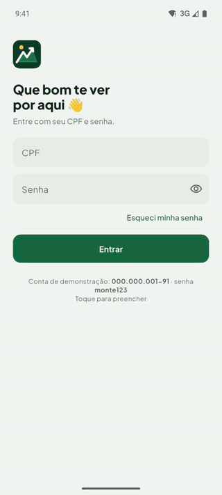

</div>

## Índice

- [Em 30 segundos](#em-30-segundos)
- [As telas](#as-telas)
- [O que o app faz](#o-que-o-app-faz)
- [Como funciona por dentro](#como-funciona-por-dentro)
- [Como rodar](#como-rodar)
  - [Pré-requisitos](#pré-requisitos)
  - [Configuração](#configuração)
  - [Rodar](#rodar)
  - [Testes](#testes)
  - [APK de release](#apk-de-release)
- [Qualidade](#qualidade)
- [Estrutura](#estrutura)
- [Créditos](#créditos)

## Em 30 segundos

O Monte é um banco de mentira com cara de app de verdade:
- **Painel:** saldo, entradas e saídas do período e as últimas movimentações.
- **Extrato:** filtros, busca, paginação e agrupamento por dia.
- **Detalhe:** cada transação aberta, com o identificador pra copiar.
- **Cripto:** uma aba com dados reais da [CoinGecko](https://www.coingecko.com/en/api).

A conta vem de um **banco simulado** dentro do próprio app, que consegue reproduzir rede caindo, erro 500, limite de requisições (429), dado quebrado e sessão expirada. Tudo fica guardado num **banco local criptografado**, então o app funciona sem internet e avisa quando o dado pode estar velho.

**Por baixo:**
- MVVM em camadas;
- Bloc/Cubit;
- flutter_modular;
- drift (SQLite) com SQLite3MultipleCiphers;
- Dio com interceptors;
- `Result` tipado;
- dinheiro sempre em inteiro.

Cada escolha está explicada em **[docs/decisoes.md](docs/decisoes.md)**.

## As telas

| Login | Painel | Extrato | Detalhe | Cripto |
|---|---|---|---|---|
| 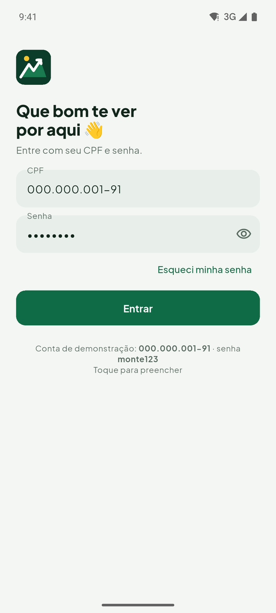 | 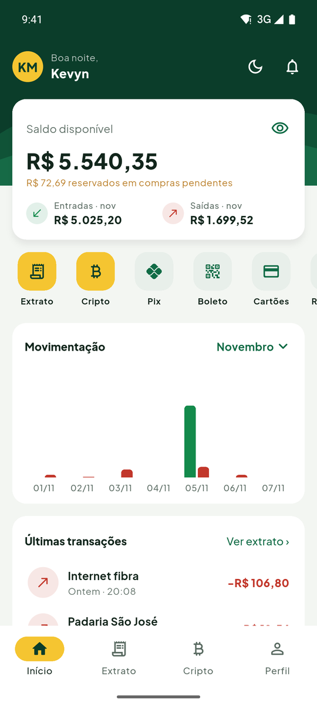 | 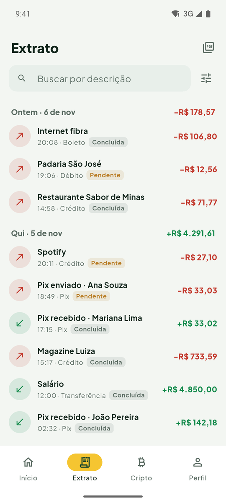 | 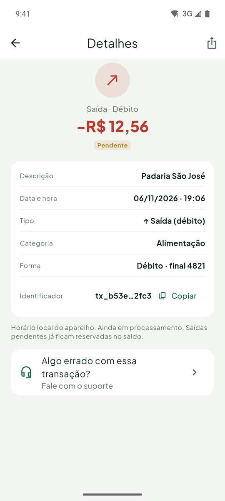 | 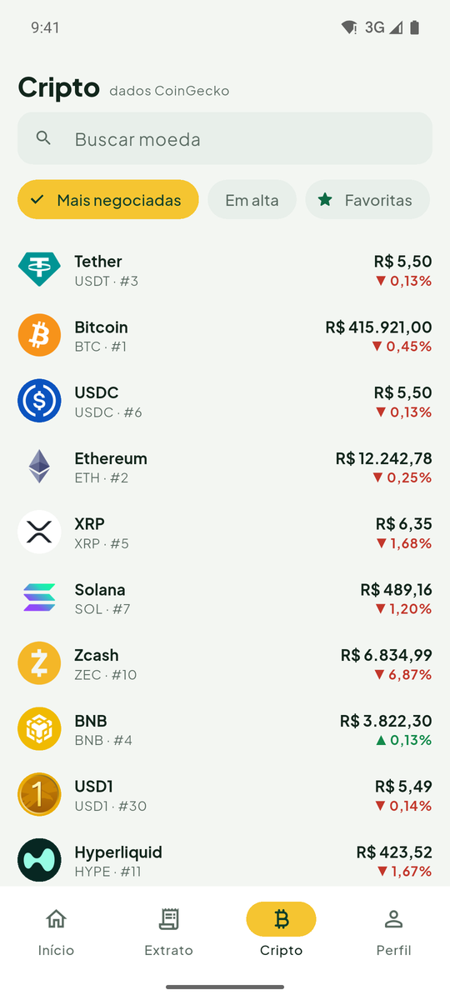 |
| 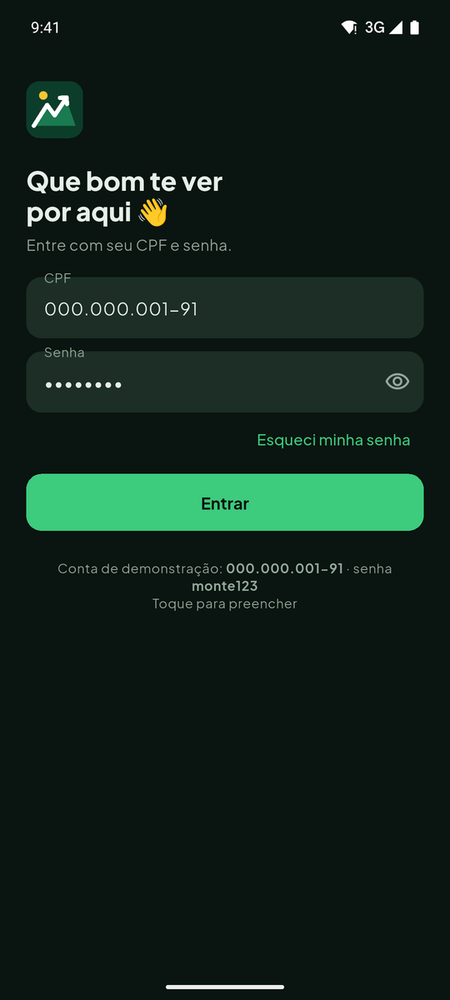 | 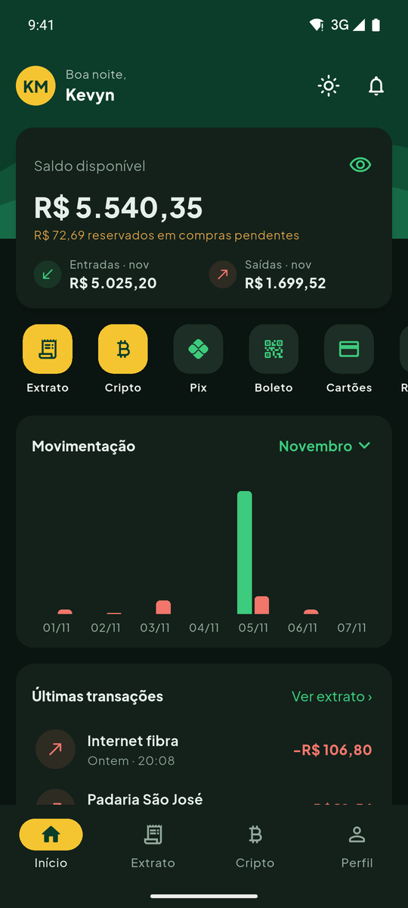 | 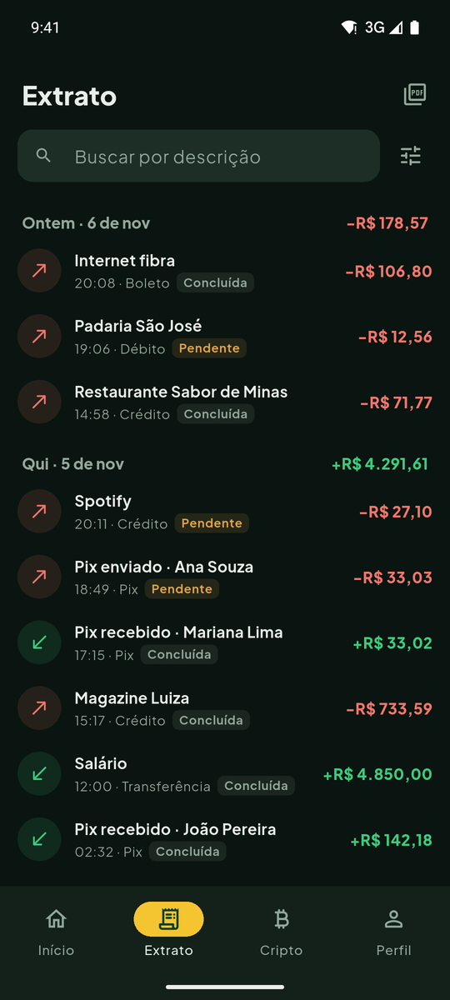 | 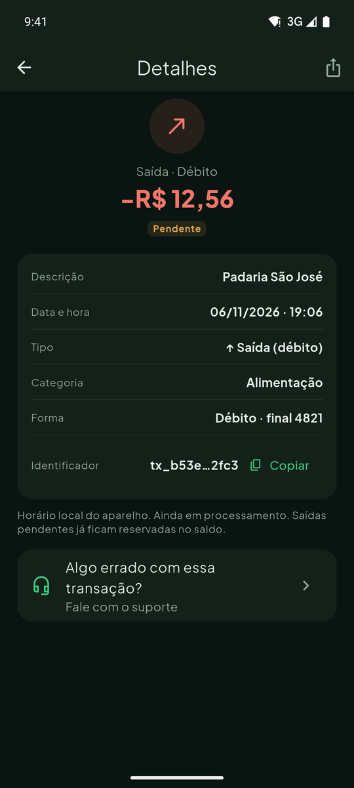 | 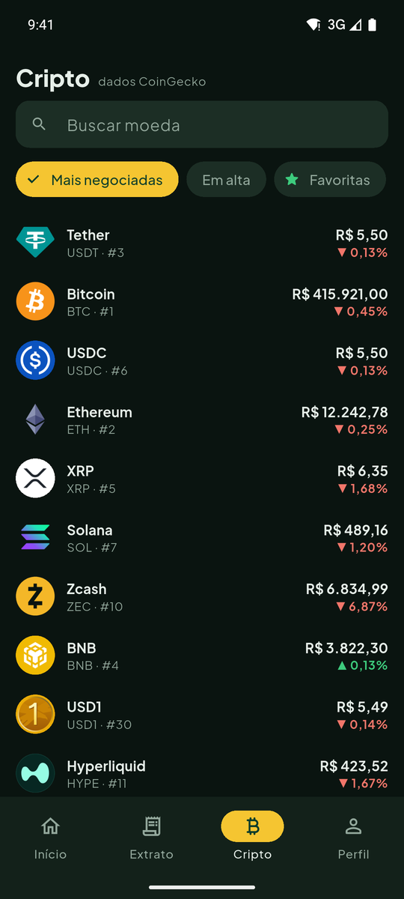 |

Tema claro e escuro, que segue o celular ou é escolhido no app.

## O que o app faz

### Painel
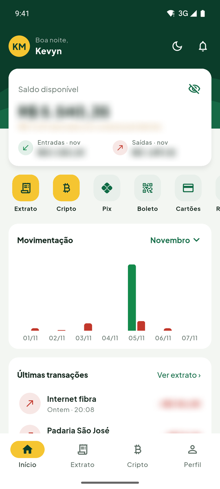

- **Saldo disponível** (o liquidado menos as compras pendentes).
- **Botão de olho pra esconder o saldo:**
  - a escolha fica salva entre as sessões;
  - o leitor de tela fala "oculto";
  - dá pra exigir a digital pra mostrar.
- **Entradas e saídas do período** (7 dias, 30 dias, este mês, mês passado ou 90 dias), com gráfico de barras.
- **As últimas movimentações**, com atalho pro extrato completo.
- **Card de cripto** com as moedas em alta.

<br clear="right">

### Extrato
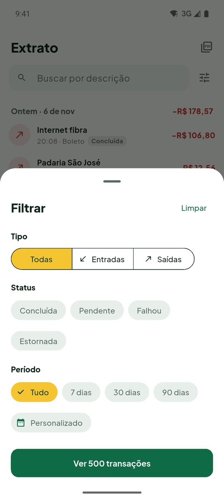

- **Cada linha mostra** descrição, data, valor e status (concluída, pendente, falha, estornada).
- **Entrada e saída se diferenciam por ícone, sinal e cor.** Nunca só pela cor.
- **Filtros que se combinam:** tipo, status e período, inclusive um intervalo escolhido pela pessoa. Cada filtro ativo vira um chip removível.
- **Busca** por descrição, que espera a pessoa parar de digitar.
- **Lista agrupada por dia**, com o total de cada dia.
- **Paginação no servidor**, 20 por vez, com cursor.
- **Ir ao detalhe e voltar** mantém os filtros e a posição da rolagem.
- **Pílula "↑ 1 nova transação"** quando chega coisa nova e a pessoa está lá embaixo.

<br clear="right">

### Detalhe da transação


- **Rota nomeada** `/extrato/transacao/:id`.
- **Mostra** o identificador (com botão de copiar), o valor, a data e a hora, o tipo, o status, o meio de pagamento, a categoria e quem enviou ou recebeu.
- **Usa os mesmos números do extrato**, porque os dois leem do mesmo banco local.

<br clear="right">

### Cripto
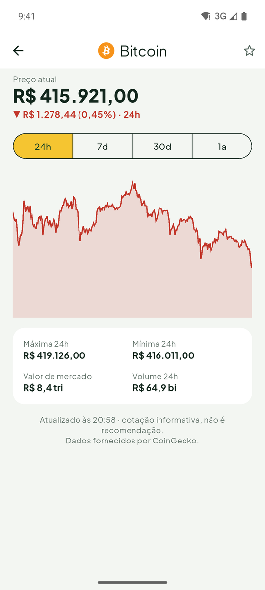

- **Lista paginada** das moedas, com a busca da CoinGecko.
- **Detalhe da moeda** com gráfico de 24 h, 7 dias, 30 dias e 1 ano.
- **Favoritas.**
- **Preço com 8 casas**, sempre em inteiro, pra moedas baratas não virarem R$ 0,00.
- **Limite de requisições (429)** respeitado: se a CoinGecko pede uma espera curta, o app espera e tenta de novo sozinho; se a espera é longa, ele avisa quanto falta.
- **Logos e preços guardados no aparelho**, pra aparecerem sem internet.

<br clear="right">

### Sem internet, sessão expirada e outras situações difíceis

| Sem internet | Sessão expirada | Em construção |
|---|---|---|
| 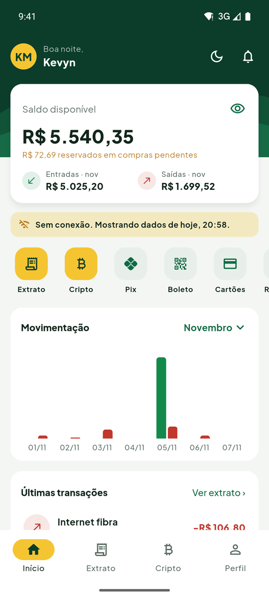 | 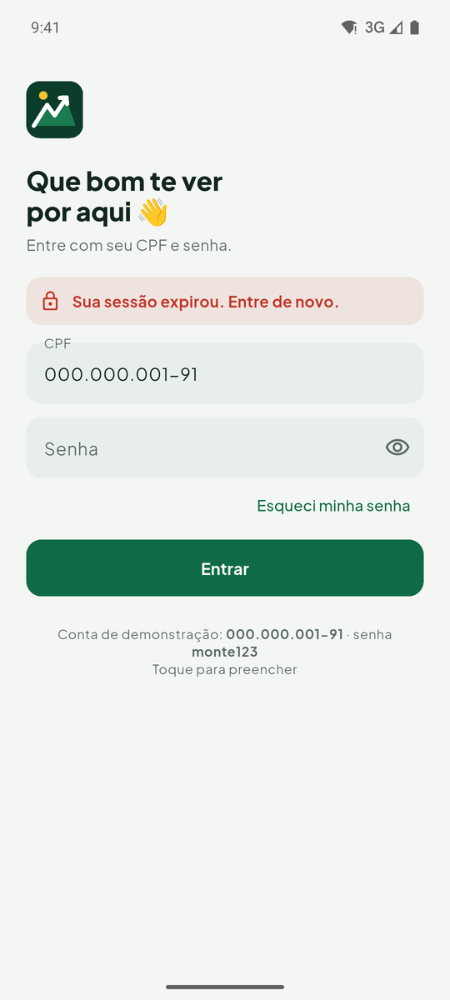 | 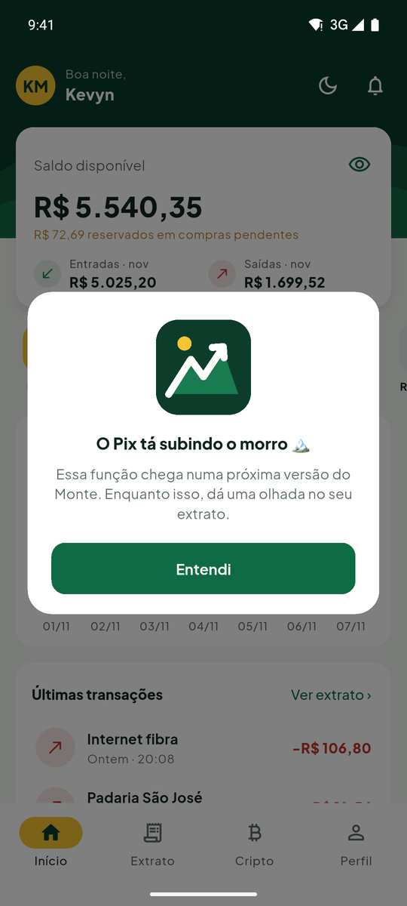 |
| Mostra o que estava guardado, com o motivo e o horário da última atualização | O banco recusou o token: o app sai de tudo uma vez só e volta pro login, explicando o porquê | As funções de banco que ficam fora do teste (Pix, transferir...) abrem uma animação própria |

Também aparecem nas situações certas:
- carregando;
- atualizando;
- puxar pra atualizar;
- vazio;
- erro com "Tentar de novo";
- login bloqueado depois de 3 erros.

### Digital

- **Entrar sem senha:** logo depois do primeiro login, o app pergunta uma vez se a pessoa quer entrar com a digital. Com ela ligada, abrir o app pede só a digital e vai direto pro painel.
- **Proteger o saldo:** vem desligado. Quem quiser liga no Perfil, e aí o olho do painel passa a pedir a digital pra mostrar o saldo (pra esconder, nunca pede).
- **Sempre tem saída:** se cancelar, errar ou o celular não tiver digital, o app volta pra senha. Sem digital cadastrada, a pergunta nem aparece.
- Liga e desliga no Perfil. Como funciona por dentro: [docs/decisoes.md#14-digital](docs/decisoes.md#14-digital).

### Perfil
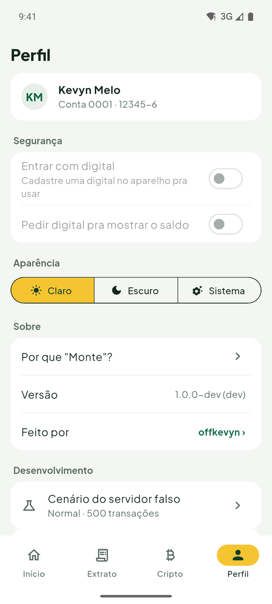

- **Digital pra entrar e pra mostrar o saldo.**
- **Escolha de tema.**
- **"Por que Monte?"**, a versão do app e o link do GitHub.
- **Sair**, que apaga a sessão e todos os dados guardados no aparelho.
- **Só na versão dev:** o seletor de cenários do banco simulado (normal, vazio, erro 500, 429, lento, offline, dado quebrado, senha errada, sessão expirada) e o "Simular Pix recebido".

<br clear="right">

## Como funciona por dentro

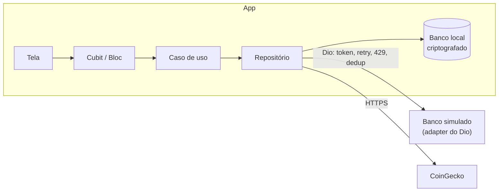

**A resposta do servidor nunca vai direto pra tela:** o app busca, grava no banco local e lê de volta. Painel, extrato e detalhe leem da mesma fonte. Por isso o saldo e os valores sempre batem, e sem internet o app continua mostrando o último dado conhecido.

A explicação completa, com os diagramas de cada fluxo, está em **[docs/decisoes.md](docs/decisoes.md)**:
- camadas;
- Bloc × Cubit;
- cache;
- paginação;
- erros;
- segurança;
- testes;
- limitações e próximos passos.

## Como rodar

### Pré-requisitos

- **Flutter 3.47.9** (stable), com Dart 3.13. A versão também está no `.fvmrc`, pra quem usa [FVM](https://fvm.app) (aí é só colocar `fvm` antes dos comandos).
- **Android SDK** e um emulador ou celular Android. O projeto foi feito e testado no Android.
- **Java 17** (vem com o Android Studio).

### Configuração

```bash
flutter pub get
cp config/example.json config/local.json
```

O `config/local.json` fica fora do git. A chave da CoinGecko é **opcional**: sem ela, o app usa o acesso público, com um limite menor. Pra usar uma chave Demo grátis, cole no arquivo:

```json
{
  "COINGECKO_API_KEY": "CG-sua-chave"
}
```

### Rodar

```bash
# versão dev (com o seletor de cenários), a padrão
flutter run --dart-define-from-file=config/local.json

# versão prod
flutter run --flavor prod --dart-define-from-file=config/local.json
```

**Conta demo:** na tela de login, toque em **"Conta de demonstração"**. Ele preenche o CPF `000.000.001-91` e a senha `monte123`.

**Seletor de cenários** (só na dev): segure o dedo no logo da tela de login, ou vá em Perfil → Desenvolvimento.

### Testes

```bash
flutter test                                 # unidade e widget (525)
flutter test --coverage                      # + coverage/lcov.info
dart run tool/check_coverage.dart 70         # confere o mínimo de 70%
flutter test integration_test                # integração (emulador aberto)
```

O relatório de cobertura fica em `coverage/lcov.info`. Pra ver em HTML: `genhtml coverage/lcov.info -o coverage/html` (precisa do lcov).

### APK de release

**Pronto:** todo PR gera um APK prod ofuscado no CI. Ele fica em **Actions → a execução → Artifacts → `monte-prod-release-apk`**.

**Local:**

```bash
flutter build apk --release --flavor prod \
  --obfuscate --split-debug-info=build/debug-info \
  --dart-define-from-file=config/local.json
```

O APK sai em `build/app/outputs/flutter-apk/app-prod-release.apk`. Os símbolos em `build/debug-info` servem pra ler um erro do app ofuscado (`flutter symbolize`).

> **Atenção:** um APK gerado com a chave leva a chave dentro dele, e ela pode ser extraída. Por isso o APK do CI é gerado sem a chave. Mais em [docs/decisoes.md#15](docs/decisoes.md#15-a-chave-da-coingecko).

**Assinatura:** se existir um `android/key.properties` (fora do git), o build usa a chave de upload. Sem ele, assina com a chave de debug, que serve pra instalar e testar.

## Qualidade

| | |
|---|---|
| **Testes** | 525 de unidade e widget + 2 fluxos de integração no emulador |
| **Cobertura** | 93,9% das linhas escritas à mão (o CI falha abaixo de 70%) |
| **Lint** | `flutter_lints` + regras extras e modo estrito do analisador (`strict-casts`, `strict-inference`, `strict-raw-types`), sem aviso pendente |
| **CI** | formatação, análise, testes em 2 fusos, cobertura, integração no emulador e APK ofuscado ([detalhes](docs/decisoes.md#17-testes-e-ci)) |
| **Commits** | Conventional Commits, um PR por funcionalidade |

## Estrutura

```
lib/
├── app/        módulo raiz, rotas, abas, tratamento da sessão expirada
├── core/       rede, banco criptografado, Result, Money, tema, componentes
└── features/   auth · ledger · dashboard · statement · crypto · profile
test/           espelha lib/
integration_test/
tool/           trava de cobertura e gerador da animação "em construção"
docs/           decisões técnicas e imagens
```

## Créditos

- **Fonte:** [Plus Jakarta Sans](https://fonts.google.com/specimen/Plus+Jakarta+Sans), licença SIL Open Font. O texto da licença vai junto no app.
- **Gráficos:** [Syncfusion Flutter Charts](https://pub.dev/packages/syncfusion_flutter_charts), licença Community.
- **Cripto:** dados da [CoinGecko API](https://www.coingecko.com/en/api).
- **Logo e animação "em construção":** feitos pro projeto. A animação é gerada por `tool/make_under_construction_lottie.py`.

---

Feito por [offkevyn](https://github.com/offkevyn).
