# Decisões técnicas do Monte

Todas as decisões do projeto ficam nesta página. Cada uma tem o mesmo formato:
- o problema;
- o que eu escolhi;
- o que ficou de fora;
- o porquê.

Quando um desenho explica melhor, tem desenho.

[← Voltar pro README](../README.md)

## Índice

**Arquitetura**
1. [Camadas e MVVM](#1-camadas-e-mvvm)
2. [Bloc no extrato, Cubit no resto](#2-bloc-no-extrato-cubit-no-resto)
3. [flutter_modular pra injeção e rotas](#3-flutter_modular-pra-injeção-e-rotas)
4. [Erros tipados com `Result`](#4-erros-tipados-com-result)

**Dados**

5. [O banco local é a fonte da verdade](#5-o-banco-local-é-a-fonte-da-verdade)
6. [Paginação no servidor, com cursor](#6-paginação-no-servidor-com-cursor)
7. [Quando buscar de novo (sem timer)](#7-quando-buscar-de-novo-sem-timer)
8. [Dinheiro sem `double`, datas em UTC](#8-dinheiro-sem-double-datas-em-utc)
9. [Banco simulado dentro do Dio](#9-banco-simulado-dentro-do-dio)
10. [Como as respostas viram domínio](#10-como-as-respostas-viram-domínio)
11. [Rede instável, 429 e chamadas duplicadas](#11-rede-instável-429-e-chamadas-duplicadas)

**Segurança**

12. [Banco criptografado, chave no Keystore](#12-banco-criptografado-chave-no-keystore)
13. [Sessão, token e 401](#13-sessão-token-e-401)
14. [Digital](#14-digital)
15. [A chave da CoinGecko](#15-a-chave-da-coingecko)

**Entrega**

16. [Flavors e build de release](#16-flavors-e-build-de-release)
17. [Testes e CI](#17-testes-e-ci)
18. [Gráfico com Syncfusion](#18-gráfico-com-syncfusion)

**Fechamento**

19. [Limitações conhecidas](#19-limitações-conhecidas)
20. [Próximos passos](#20-próximos-passos)

---

## 1. Camadas e MVVM

**Problema.** Um app de banco cresce rápido e passa por muitas mãos. Tela, regra de negócio e acesso a dados precisam ficar separados, senão qualquer mudança quebra outra parte.

**Escolha.** Cada funcionalidade é uma pasta com as três camadas. O que é comum a todas fica em `core/`.

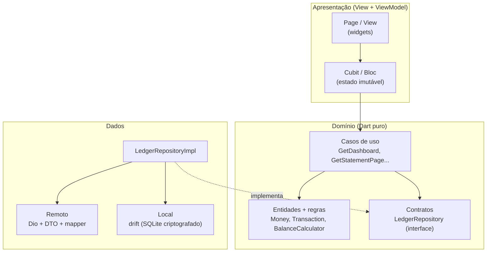

- **View** = a página e os widgets. Não tem regra nenhuma.
- **ViewModel** = Cubit ou Bloc. Recebe o que a tela quer, chama o caso de uso e solta um estado imutável.
- **Domínio** não importa Flutter nem Dio. As regras de dinheiro moram aqui: saldo disponível, totais do período, agrupamento por dia.
- **Dados** implementa os contratos do domínio. É o único lugar que conhece JSON, SQL e HTTP.

A apresentação conhece só a interface do repositório, nunca a implementação. Por isso todo Cubit e todo Bloc é testado com um repositório de mentira.

**Ficou de fora:**
- Pastas por tipo na raiz (`lib/models/`, `lib/views/`, `lib/services/`), juntando as telas de todas as funcionalidades numa pasta só. Com 6 funcionalidades, uma mudança no extrato já passaria por 5 pastas. A divisão por camada existe, mas dentro de cada funcionalidade (`data/`, `domain/`, `presentation/`).
- Um pacote separado por camada. Seria exagero pra esse tamanho.

```
lib/
├── app/          módulo raiz, rotas, abas, sessão expirada
├── core/         rede, banco criptografado, Result, Money, tema, UI comum
└── features/
    ├── auth/        login, splash, sessão
    ├── ledger/      domínio e dados da conta (compartilhado)
    ├── dashboard/   painel
    ├── statement/   extrato e detalhe
    ├── crypto/      CoinGecko
    └── profile/     perfil
```

`ledger` não tem tela: é a conta (entidades, regras, repositório), usada pelo painel, pelo extrato e pelo detalhe. Por isso os três mostram sempre os mesmos números.

---

## 2. Bloc no extrato, Cubit no resto

**Problema.** A tela precisa mostrar sempre um estado coerente, sem que um pedaço mude sozinho no meio do caminho. E cada tela tem um nível diferente de complexidade.

**Escolha:**
- **Bloc** no extrato, porque é a única tela que precisa controlar a *ordem* dos eventos.
- **Cubit** no resto (painel, detalhe, cripto, login, perfil), onde chamar um método basta.

O extrato usa um modo de tratar evento pra cada tipo de pedido:

| Evento | Modo | O que garante |
|---|---|---|
| Digitar na busca | debounce de 350 ms + `restartable` | Só busca quando a pessoa para de digitar, e a busca nova cancela a velha |
| Filtro, abrir, puxar pra atualizar | `restartable` (uma fila só) | Uma resposta antiga nunca substitui a nova. Tem teste com respostas chegando fora de ordem |
| Rolar até o fim | `droppable` | Rolar rápido não pede a mesma página duas vezes |

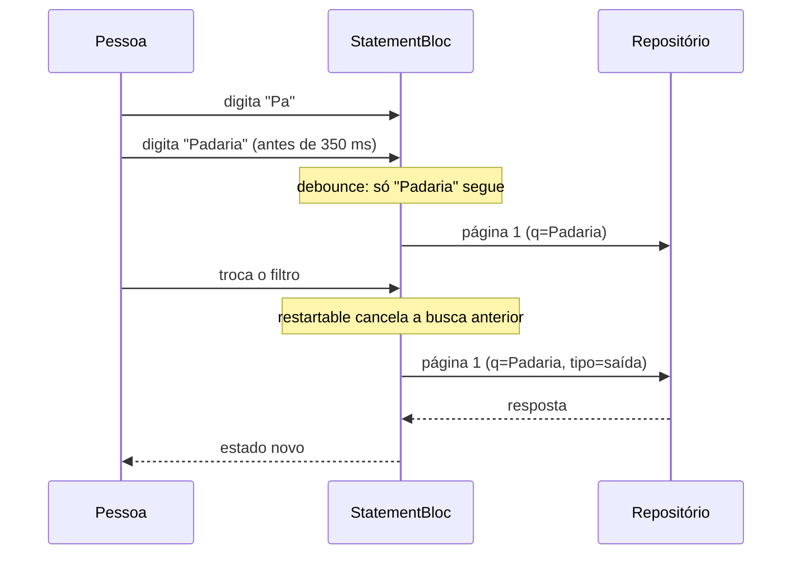

**Ficou de fora:**
- **Bloc em tudo.** O painel ganharia classes de evento sem ganhar nada com isso.
- **Riverpod/Provider.** Atenderiam, mas os modos de evento do `bloc_concurrency` resolvem o extrato quase sem código. E é o padrão que eu já uso no dia a dia.

**Consequência:** o `bloc_test` não entrou porque deu conflito de versão com o drift. Os Cubits e o Bloc são testados escutando o `stream` direto.

---

## 3. flutter_modular pra injeção e rotas

**Problema.** As partes do app precisam depender de contratos, não de implementações, pra dar pra trocar e testar cada uma. E cada transação precisa ter um endereço próprio, que dá pra abrir direto.

**Escolha.** `flutter_modular` **6.4.1**, travado no `pubspec`. Cada módulo declara as dependências e as rotas dele juntas:

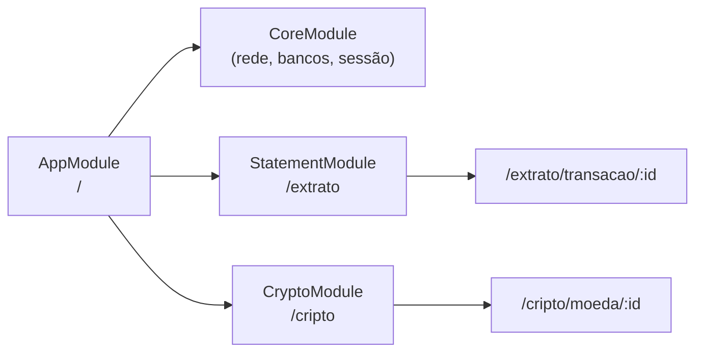

- Cada dependência é registrada pela interface (`LedgerRepository` → `LedgerRepositoryImpl`). O teste troca a implementação por uma de mentira.
- O que é de um módulo é descartado quando se sai das rotas dele.
- O id que vem na rota é tratado como entrada do usuário: `GetTransactionDetail` valida o formato antes de consultar.

**Ficou de fora:**
- **A versão 7 do Modular:** foi reescrita do zero em junho de 2026. Num app financeiro, preferi a versão estável que eu domino. Migrar seria trocar a forma de declarar os módulos, sem mudar a arquitetura.
- **get_it + go_router:** são duas bibliotecas pra fazer o que uma faz.

**Cuidado que apareceu:** o Modular e o flutter_bloc têm um `context.read` cada. Resolvi com `hide ModularWatchExtension` no import.

---

## 4. Erros tipados com `Result`

**Problema.** Nenhuma exceção pode chegar crua na tela.

**Escolha.** Montei um `sealed class Result<T>` (sucesso ou falha) e uma hierarquia de `Failure`. A camada de dados captura as exceções e as converte. Do repositório pra cima, tudo é `Result`.

```dart
switch (result) {
  case Ok(:final value): ...
  case Err(:final failure): ...
}
```

Exemplos de `Failure`:
- `NoConnectionFailure`
- `TimeoutFailure`
- `ServerFailure`
- `RateLimitedFailure` (traz o tempo de espera)
- `UnauthorizedFailure`
- `InvalidCredentialsFailure`
- `AccountLockedFailure`
- `NotFoundFailure`
- `InvalidDataFailure`
- `StorageFailure`
- `CancelledFailure`

O texto que aparece na tela sai de um `switch` exaustivo (`failure_message.dart`). Se alguém criar uma falha nova e esquecer de tratar, **o código não compila**. Aconteceu de verdade quando criei a `CancelledFailure`.

**Ficou de fora:** `Either` do `fpdart` ou `dartz`. É uma dependência inteira pra usar só um tipo, e com o `sealed` do Dart 3 o compilador já confere os casos.

---

## 5. O banco local é a fonte da verdade

**Problema.** Saldo, totais e valores têm que bater entre painel, extrato e detalhe. E o app precisa mostrar o último dado conhecido quando estiver sem rede.

**Escolha.** A resposta do servidor **nunca vai direto pra tela**. O caminho é sempre o mesmo:

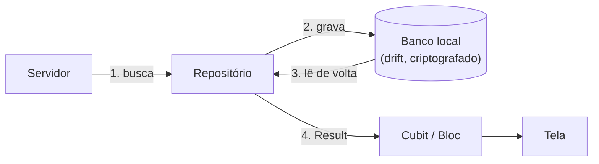

- Painel, extrato e detalhe leem do mesmo banco. Uma transação aberta no detalhe é a mesma linha que aparece no extrato.
- **Sem rede:** o repositório devolve o que está guardado, junto com a idade do dado (`DataFreshness`). A tela mostra a faixa amarela com o motivo e o horário da última atualização.
- **Painel:** os 4 pedidos (saldo, pendentes, recentes, período) vão juntos. Se um falhar, **nada é gravado**, pra nunca ficar meio atualizado. Quando o período não está inteiro no aparelho, aparece "—" em vez de um total parcial.

| Sem internet, com dado guardado | Sem nada guardado |
|---|---|
| 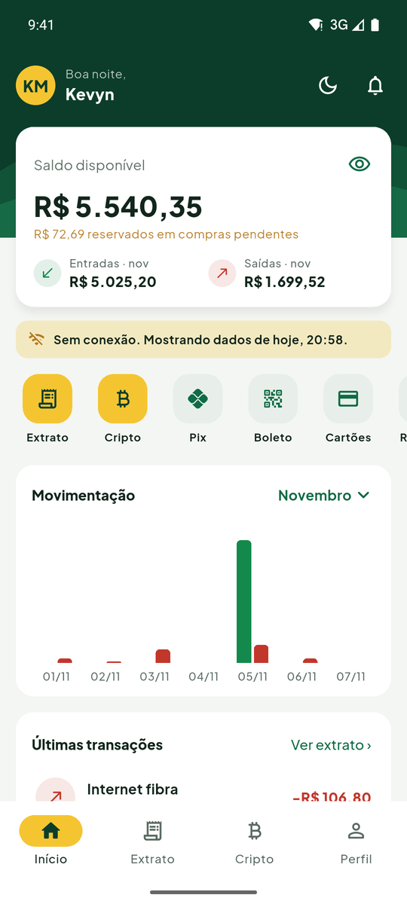 | 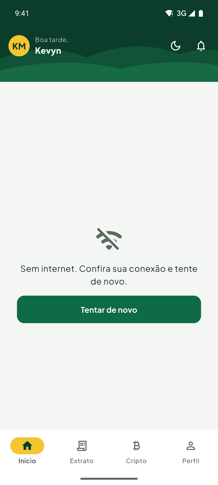 |

**O que fica guardado:**
- as 200 transações mais recentes;
- o período do painel;
- as pendentes;
- as últimas 50 abertas no detalhe.

Uma faxina roda a cada atualização. O banco é uma cópia: se a estrutura mudar de versão, as tabelas são recriadas e baixadas de novo.

**Ficou de fora:**
- **Cache em memória:** some quando o app fecha, e sem rede o app precisa mostrar o último dado conhecido.
- **Hive / shared_preferences:** não fazem consulta com filtro, nem contagem, nem ordenação por data e id. O extrato offline precisa disso.

---

## 6. Paginação no servidor, com cursor

**Problema.** Um histórico de conta não tem fim. Baixar tudo pra paginar no celular não escala, e quem filtra ou busca rápido não pode receber resposta de um pedido antigo.

**Escolha.** O extrato pede **20 por vez** ao servidor, com o filtro e a busca na própria URL:

```
GET /v1/transactions?limit=20&type=debit&status=completed&from=...&to=...&q=padaria&cursor=...
```

- **Cursor = data + id da última transação** (o que se chama de *keyset*). Uma transação nova que chega no topo não empurra a lista, então nada se repete nem pula. O número de página quebraria nesse caso.
- **Trocar o filtro cancela o pedido anterior** (`CancelSignal` → `CancelToken` do Dio).
- **Abrir o extrato mostra primeiro o que está guardado** e atualiza por trás, com uma barrinha fina no topo. O esqueleto de carregamento só aparece quando não tem nada guardado.
- **Limite de 200 na rolagem.** Depois disso aparece "Pra ver transações mais antigas, use a busca ou o filtro de período". Assim a memória da tela fica do tamanho do que o banco guarda.
- **Pílula "↑ 1 nova transação".** Se a pessoa volta pro app lá embaixo da lista e chegou coisa nova, a lista não pula. As novas esperam atrás da pílula.

| Extrato | Filtros | Busca |
|---|---|---|
| 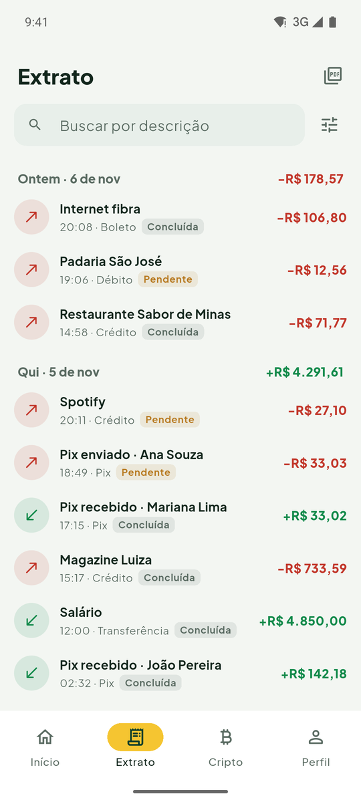 | 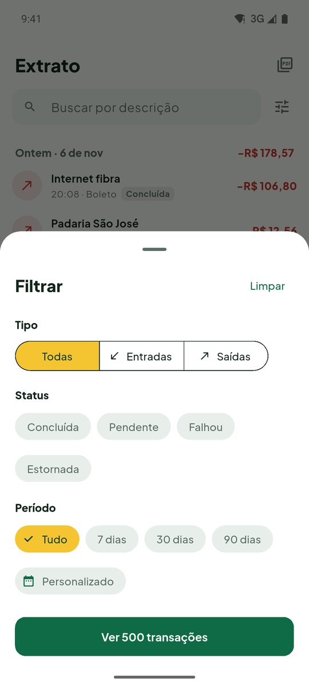 | 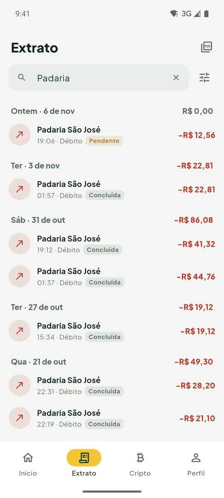 |

**Posição e filtros preservados.** As abas ficam num `IndexedStack` e a lista tem uma `PageStorageKey`. Ir ao detalhe e voltar mantém o filtro e o ponto da rolagem.

**Ficou de fora:** baixar a conta inteira e calcular tudo no celular. Foi a primeira versão. Troquei porque o saldo é responsabilidade do servidor e o histórico cresce sem limite.

---

## 7. Quando buscar de novo (sem timer)

**Problema.** Evitar chamadas repetidas sem deixar o dado velho.

**Escolha.** Nenhum timer fica rodando. O repositório só age quando a tela pede: abrir, trocar de aba, voltar pro app, puxar pra atualizar ou rolar. Na hora do pedido, ele aplica a regra:

| Dado | Pede de novo se... | Depois de uma falha |
|---|---|---|
| Painel e extrato | o último pedido tem mais de 30 s | responde do banco |
| Lista de cripto | o dado tem mais de 60 s | espera 30 s antes de tentar de novo |
| Gráfico de uma moeda | o dado tem mais de 5 min | espera 30 s |

**Puxar pra atualizar sempre vai ao servidor.**

**Cripto também tem faxina:**
- o gráfico fica guardado só pras favoritas e pras últimas 20 moedas abertas;
- moeda sem uso por 7 dias sai do banco.

**Ficou de fora:** atualizar a cada X segundos. Gasta bateria e cota da API pra uma tela que talvez nem esteja aberta.

---

## 8. Dinheiro sem `double`, datas em UTC

**Problema.** `double` erra centavos (0,1 + 0,2 não dá 0,3), e isso num extrato é inaceitável. Datas também enganam: a mesma transação não pode cair em dias diferentes conforme o fuso do celular.

**Escolha:**
- **`Money`:** inteiro em centavos. Soma, subtração e formatação em pt-BR (`intl`).
- **`CryptoPrice`:** inteiro com 8 casas decimais. A SHIB vale R$ 0,0000712, e em centavos viraria R$ 0,00. Continua sendo inteiro, nada de `double`.
- **No gráfico do painel**, o valor só vira `double` na altura da barra. O texto ao tocar na barra formata os centavos originais.
- **Datas:**
  - trafegam e são gravadas em UTC (ISO 8601);
  - só viram horário local na tela e no agrupamento por dia (`LocalCalendar`);
  - **o CI roda os testes duas vezes**, com o relógio em `America/Sao_Paulo` e em `UTC`, pra provar que o agrupamento não depende do fuso do aparelho.

**As regras de dinheiro moram no domínio** (`BalanceCalculator`, `PeriodSummarizer`), com testes de borda: zero, volume grande, arredondamento e virada de dia.
- **Saldo disponível = saldo liquidado (do servidor) − saídas pendentes.** Uma compra pendente já reserva o dinheiro. Entrada pendente, falha e estorno não mexem no saldo.
- **Totais e gráfico do período contam só as concluídas.** O gráfico usa barra por dia até 31 dias e barra por semana acima disso.

---

## 9. Banco simulado dentro do Dio

**Problema.** A CoinGecko não tem dado bancário. Precisava de um backend pra conta que desse pra controlar na apresentação: vazio, erro, 429, lento, offline, dado quebrado, sessão expirada.

**Escolha.** Um **adapter** do Dio (`FakeHttpAdapter`) com rotas falsas:
- `POST /v1/auth/login`
- `GET /v1/account`
- `GET /v1/transactions`
- `GET /v1/transactions/:id`

Ele troca **só o transporte**. Nova tentativa, 429, validação do JSON, token e cancelamento rodam exatamente como rodariam com uma API real. A URL base usa o domínio reservado `.invalid`, então o app nunca chama um servidor de verdade por engano.

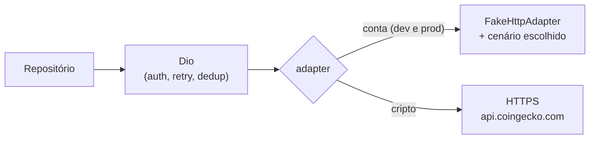

No flavor **dev**, um seletor escondido (segurar o dedo no logo do login, ou ir em Perfil → Desenvolvimento) troca o cenário ao vivo. No **prod**, o seletor nem é compilado (ver [16](#16-flavors-e-build-de-release)).

**Ficou de fora:**
- **json-server:** é mais um processo pra subir, e quem fosse rodar o app precisaria dele ligado na mesma rede.
- **Interceptor:** ficaria antes do retry e do tratamento de 429, e aí esses caminhos nunca seriam exercitados.

---

## 10. Como as respostas viram domínio

As respostas passam por três etapas, e uma etapa nunca faz o trabalho da outra:
1. **DTO:** confere o formato (`JsonReader`, que dá erro claro pra campo faltando ou com tipo errado).
2. **Mapper:** dá significado aos campos.
3. **Entidade:** o resultado já validado.

**Banco simulado → conta**

| JSON | Domínio | Regra |
|---|---|---|
| `amount_cents` (int) | `Money` | Nunca negativo: o sinal vem de `direction` |
| `direction`: `credit` / `debit` | `TransactionType.income` / `expense` | Valor desconhecido = registro inválido |
| `status`: `completed`, `pending`, `failed`, `reversed` | `TransactionStatus` | Status desconhecido é **recusado**, porque pode esconder uma falha |
| `payment_method`: `pix`, `credit_card`, `debit_card`, `boleto`, `bank_transfer` | `PaymentMethod` | Valor desconhecido = registro inválido |
| `category` | `TransactionCategory` | Categoria desconhecida vira "outros", que é inofensivo |
| `occurred_at` (ISO 8601) | `DateTime` UTC | |
| `balance_cents` em `/v1/account` | saldo liquidado | O servidor calcula, e o app só desconta as saídas pendentes |

**CoinGecko → cripto**

| Endpoint | Domínio |
|---|---|
| `/coins/markets` (vs_currency=brl) | `Coin` com `CryptoPrice` (8 casas), variação de 24 h e valor de mercado em `Money` |
| `/coins/{id}/market_chart` | lista de pontos (data, `CryptoPrice`) pro gráfico |
| `/search`, `/search/trending` | ids, depois completados por `/coins/markets` |

**Dado quebrado não derruba a lista.** Um item ilegível é pulado e contado ("uma transação estranha não esconde as outras dezenove"). O número chega até o repositório, que registra o caso.

---

## 11. Rede instável, 429 e chamadas duplicadas

**Escolha.** Três interceptors no Dio, cada um com uma função:

- **`RetryInterceptor`:**
  - repete só `GET`, até 3 vezes, com espera crescente (400 ms → 800 ms → 1,6 s, mais até 30% de variação aleatória pra vários celulares não baterem juntos no servidor);
  - `POST` não é repetido, porque o login conta tentativas;
  - no **429**, respeita o `Retry-After`. Se o servidor pedir mais de 10 s, o app desiste e avisa pra aguardar, em vez de travar a tela.
- **`RequestDeduplicator`:** dois pedidos iguais ao mesmo tempo viram um só. O pedido de verdade só é cancelado quando **todos** os interessados desistem.
- **`AuthInterceptor`:** põe o token em todo pedido do banco (ver [13](#13-sessão-token-e-401)).

Na cripto, a espera de 30 s depois de uma falha (ver [7](#7-quando-buscar-de-novo-sem-timer)) existe porque insistir durante o bloqueio da CoinGecko só estica o bloqueio.

---

## 12. Banco criptografado, chave no Keystore

**Problema.** O extrato guardado no aparelho é dado financeiro.

**Escolha:**
- **Dois bancos SQLite criptografados** (SQLite3MultipleCiphers, cifra ChaCha20):
  - `ledger.db` (conta);
  - `market.db` (cripto).
- **A chave** são 32 bytes aleatórios, guardados no `flutter_secure_storage` (Keystore no Android). Ela é usada no `PRAGMA key` ao abrir o banco e nunca vai pro log nem pro `shared_preferences`.
- **Trava:** se o SQLite embutido vier sem criptografia, o app se recusa a abrir, em vez de gravar em texto puro.
- **Chave perdida** (backup restaurado em outro celular): o arquivo é descartado e baixado de novo, porque é só cópia. O backup do Android está desligado no manifesto.
- **Dois bancos** porque têm donos diferentes (conta do cliente × dado público), jeitos diferentes de sincronizar, e cada um evolui a própria versão. A infraestrutura é a mesma, em `core/storage`.

**Ficou de fora:** o SQLCipher. O pacote `sqlcipher_flutter_libs` foi descontinuado, e o próprio `sqlite3` 3.x já oferece a build com criptografia.

---

## 13. Sessão, token e 401

**Escolha:**
- **O login nunca diz "CPF não existe".** CPF desconhecido e senha errada recebem a mesma resposta, pra ninguém descobrir quem tem conta. Três erros bloqueiam o login por 5 min (HTTP 423).
- **O token fica no armazenamento seguro** e não aparece em log (o `toString` esconde). Todo pedido ao banco leva `Authorization: Bearer <token>`, menos o login.
- **Sessão guardada não abre a conta sozinha.** O app pede a senha de novo, a não ser que a digital esteja ligada (ver [14](#14-digital)).

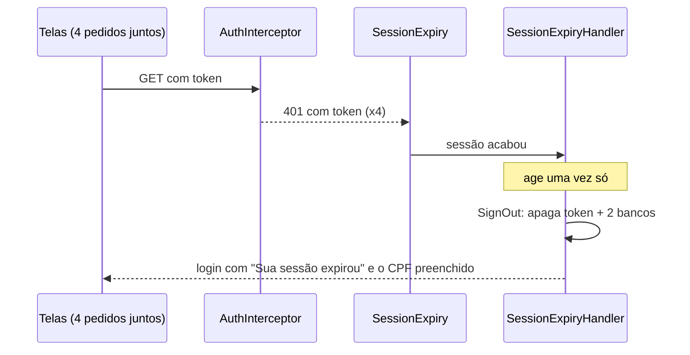

- **401 sem token** é senha errada: não sai de nada.
- **Sair da conta**, seja pelo botão, por sessão vencida ao abrir ou por token recusado, segue **um caminho só**: apaga a sessão e os dois bancos. Se um deles falhar ao apagar, os outros continuam sendo apagados.
- **Outro CPF entrando no mesmo celular:** o que estava guardado é apagado quando o login novo é aceito.

| Sessão expirada |
|---|
| 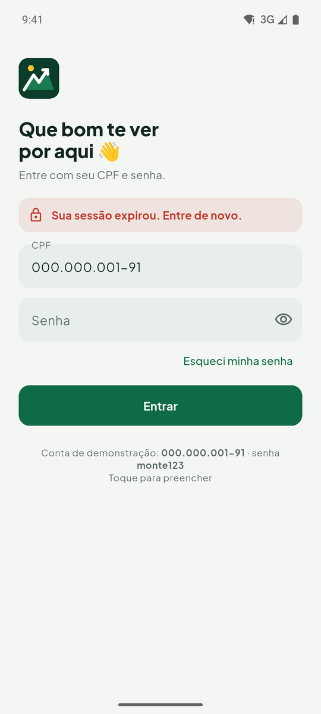 |

**Num banco de verdade:** um JWT assinado pelo servidor e um refresh token pra renovar a sessão sem pedir senha.

---

## 14. Digital

**Problema.** Digitar a senha toda vez que abre o app cansa. E esconder o saldo não protege nada se qualquer pessoa com o celular destravado pode tocar no olho.

**Escolha.** A digital é opcional e serve pra duas coisas: entrar sem digitar a senha e proteger o saldo.

| Quando | O que acontece |
|---|---|
| **Logo depois do primeiro login** | Se o celular tem digital cadastrada, o app pergunta **uma vez só**: "Entrar com a digital?". "Usar digital" já pede a digital ali, pra confirmar que funciona. "Agora não" não pergunta de novo. Dá pra ligar depois no Perfil. |
| **Ao abrir o app** | Veja o desenho abaixo. |
| **Ao mostrar o saldo** | Com "Pedir digital pra mostrar o saldo" ligado, o olho pede a digital pra **mostrar**. Pra esconder, nunca pede. |
| **No Perfil** | Ligar "Entrar com digital" pede a digital antes. Desligar não pede, porque só deixa o app mais seguro. A proteção do saldo pede a digital pra ligar **e** pra desligar, senão quem pegasse o celular destravado desligava a proteção e via o saldo. |

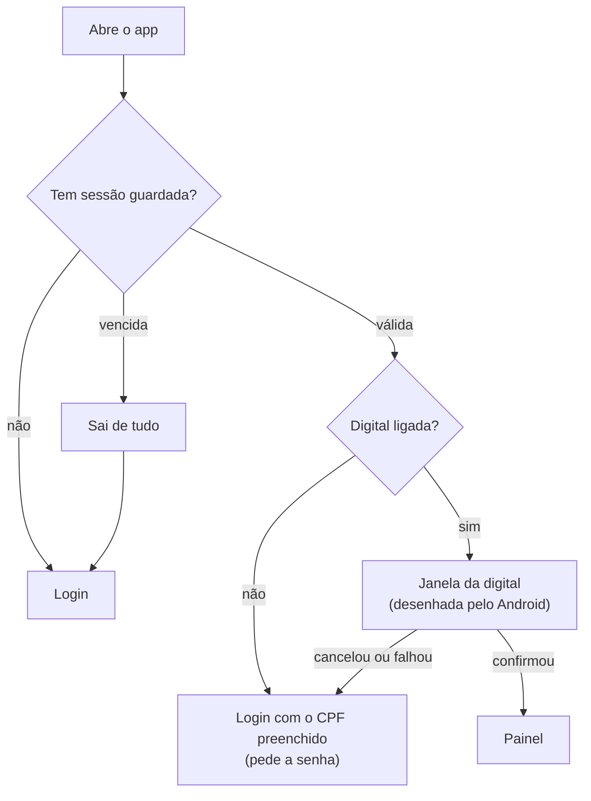

- **Celular sem digital cadastrada:** a pergunta depois do login não aparece, e no Perfil as duas opções ficam desligadas, com o aviso "Cadastre uma digital no aparelho pra usar".
- **Nunca dá erro na tela.** A digital fica atrás de uma interface (`BiometricAuthenticator`), em volta do plugin `local_auth`. Qualquer problema (cancelou, errou demais e o Android bloqueou, a digital foi apagada do celular) vira "não confirmado", e o app volta pra senha.
- **A escolha é do aparelho, não da conta.** Ela fica nas preferências e continua valendo depois de "Sair". O próximo login não pergunta de novo.
- **Testes:** os de unidade cobrem confirmou, recusou e celular sem digital. A janela em si é do Android, e o teste não alcança (ver [17](#17-testes-e-ci)).

**Ficou de fora:**
- **Perguntar a cada login.** Vira chatice. O app pergunta uma vez, e quem mudar de ideia liga no Perfil.
- **Prender a chave do token à digital** (Android Keystore com `CryptoObject`). Hoje quem decide se a digital passou é o app. Nesse outro jeito, quem decide é o chip de segurança do celular, e nem um app modificado leria o token sem o dedo. Ficou de fora porque o ataque exige o celular na mão, root e conhecimento técnico, e porque cadastrar uma digital nova invalida a chave, o que pede mais um fluxo de recuperação. Está nas [limitações](#19-limitações-conhecidas).

---

## 15. A chave da CoinGecko

**Problema.** Chave de API no código-fonte vaza junto com o repositório.

**Escolha:**
- **Chave fora do git.** Ela fica em `config/local.json`, que o git ignora, e entra no build com `--dart-define-from-file`. O repositório traz só o `config/example.json`.
- **Chave sempre no cabeçalho** (`x-cg-demo-api-key`), nunca na URL, que costuma parar em log.
- **Sem chave, o app funciona** com o acesso público da CoinGecko, só com um limite menor.

**O que o projeto prova:** tudo que vai num APK pode ser extraído. Testei: num APK gerado com a chave, ela aparece em texto puro dentro do binário, mesmo com a ofuscação. Ofuscar troca os nomes do código, mas não esconde os textos. Por isso:
- o **APK do CI é gerado sem a chave** e usa o acesso público;
- a chave Demo só é aceitável porque é grátis e só de leitura;
- **em produção**, a chave ficaria num backend pequeno (uma Cloud Function com Secret Manager e App Check), que repassaria os pedidos.

---

## 16. Flavors e build de release

**Escolha.** Duas versões do app, que instalam lado a lado no celular:

| | dev | prod |
|---|---|---|
| Nome | Monte Dev | Monte |
| Pacote | `com.offkevyn.monte.dev` | `com.offkevyn.monte` |
| Versão | `1.0.0-dev` | `1.0.0` |
| Seletor de cenários | ✅ | não existe no APK |

- `flutter run` sem nada abre a **dev** (`default-flavor: dev` no `pubspec`).
- **O seletor nem é compilado no prod.** `devToolsEnabled = appFlavor == 'dev'` é uma constante de compilação, então o compilador corta todo `if (devToolsEnabled)`. Conferi abrindo o binário: os textos do seletor não estão lá.
- **Release ofuscado no CI:**
  - o build usa `--obfuscate --split-debug-info`, e os nomes das classes somem do binário;
  - os símbolos ficam guardados à parte, pra transformar um erro embaralhado em legível (`flutter symbolize`).
- **Assinatura:** se existir um `android/key.properties` (fora do git), o build usa a chave de upload. Sem ele, assina com a chave de debug, que dá pra instalar e testar.

**Ficou de fora:** flavors no iOS. O projeto foi feito e testado no Android, e o iOS precisaria de schemes no Xcode.

---

## 17. Testes e CI

**Escolha.** Uma pirâmide de testes:

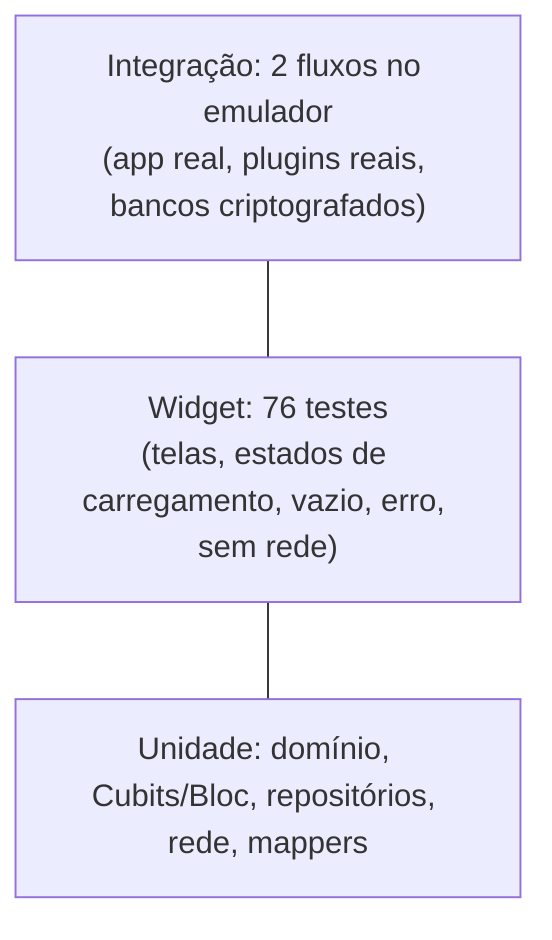

- **520 testes** de unidade e de widget, com **93,9%** de cobertura das linhas escritas à mão (os arquivos gerados, `.g.dart`, ficam fora da conta).
- **Determinísticos:**
  - o relógio é injetado (`Clock`);
  - o banco simulado tem semente fixa;
  - nos testes de widget, o tempo é falso.
- **Integração**, que roda num emulador de verdade:
  - o fluxo principal: login → painel → extrato → busca → detalhe → cripto → sair;
  - erro e recuperação: o app mostra o erro e volta a funcionar quando o servidor volta, sem reiniciar.

  Só a CoinGecko é respondida localmente, no transporte HTTP, pra não depender de rede nem de cota.

**CI (GitHub Actions)** em todo PR e em todo push na `main`:

| Etapa | O que pega |
|---|---|
| Formatação + `flutter analyze` | código fora do padrão, aviso de lint (as regras são rígidas, sem nada pendente) |
| Testes com relógio em `America/Sao_Paulo` e em `UTC` | regra que dependa do fuso do aparelho |
| Cobertura ≥ 70% (`tool/check_coverage.dart`) | código novo sem teste |
| Integração no emulador Android 14 | o que só quebra rodando de verdade |
| APK prod ofuscado | build de release quebrado. O APK fica pra baixar em *Artifacts* |

**Bugs que essas camadas pegaram de verdade:**
- **No emulador do CI:** a mensagem de "nada encontrado" estourando a tela num celular pequeno com o teclado aberto.
- **No teste do app inteiro:** a rota do login quebrando quando abria sem argumento.
- **Em teste de unidade:** uma busca misturando linhas da lista anterior.

**Ficou sem cobertura (de propósito):**
- **A janela da digital**, que é desenhada pelo Android e o teste não alcança. O que o app faz com a resposta (sim, não, sem digital) está nos testes de unidade.
- **Golden tests** (comparar a tela pixel a pixel): ficaram pra depois.
- **A CoinGecko de verdade no CI**, por causa da cota e da instabilidade.

---

## 18. Gráfico com Syncfusion

**Escolha.** `syncfusion_flutter_charts` pro gráfico de entradas e saídas do painel e pro gráfico de preço da moeda.

**Por quê:**
- tem tooltip, eixo de data e animação prontos;
- a licença Community é grátis pra pessoa física e empresas pequenas.

**Ficou de fora:** `fl_chart`. Também atenderia, mas exigiria montar à mão o tooltip formatado e o eixo de datas.

---

## 19. Limitações conhecidas

- **iOS:** o projeto foi feito e testado no Android. O iOS não foi testado, e os flavors só foram configurados no Android.
- **O banco é simulado.** A sessão é um token com validade embutida, não um JWT assinado.
- **A digital é uma porta dentro do app.** O token fica no armazenamento seguro, mas não fica preso à digital. Num banco de verdade, a chave que protege o token ficaria presa à digital no chip de segurança do celular (Android Keystore com `CryptoObject`), e nem um app modificado conseguiria pular essa etapa.
- **A tela pede os dados, mas não "assiste" o banco.** Uma gravação feita por outro caminho só aparece na próxima vez que a tela pedir.
- **Sem tempo real.** Um Pix recebido aparece quando a pessoa volta pro app ou puxa pra atualizar.
- **Sem certificate pinning.** Fixar o certificado da CoinGecko quebraria o app a cada troca de certificado deles. Faz sentido com um backend próprio.
- **Sem observabilidade** (Crashlytics, Sentry). Os erros são tratados e registrados localmente, mas não são enviados pra lugar nenhum.

## 20. Próximos passos

Pela ordem que eu faria:

1. **Tela assistindo o banco.** Com o `watch()` do drift (um Stream), a tela se inscreve numa consulta, e o servidor só escreve no banco. Qualquer gravação aparece sozinha em todas as telas, como no `snapshots()` do Firestore. Ainda não fiz porque mexe no fluxo de todas as telas, e hoje toda gravação no banco já parte da própria tela, que sabe que precisa recarregar. Passa a valer a pena junto com o item 2.
2. **Tempo real.** Um push (FCM) ou SSE avisando "chegou transação". O app busca só o que é novo, grava, e a tela atualiza sozinha, o que se junta perfeitamente com o item 1.
3. **Backend pra chave da CoinGecko** (Cloud Function + Secret Manager + App Check).
4. **Crashlytics** com os símbolos que o CI já guarda, pra ler os erros do APK ofuscado.
5. **Sincronização incremental** (`updated_since`) no lugar da página 1 inteira.
6. **Teste de arquitetura no CI.** Um teste que lê os `import` de cada arquivo e falha se o domínio usar dados, Flutter, Dio ou drift. Hoje essa regra é garantida por revisão (e o domínio está limpo); o teste faria o PR ficar vermelho na hora.
7. **Digital no teste de integração** (`adb emu finger touch` ou Patrol) e **golden tests** das telas principais.
8. **Com mais pessoas no time:**
   - um pacote por funcionalidade;
   - CODEOWNERS;
   - testes de contrato com o backend real.
